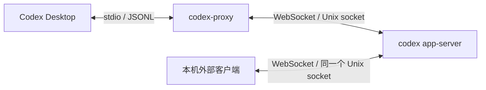

# codex-proxy

`codex-proxy` 是一个 Go 启动器，让 Codex Desktop 和其他本机客户端可以连接同一个 `codex app-server`。

## 架构



1. Codex Desktop 通过 `CODEX_CLI_PATH` 启动 `codex-proxy`，并通过标准输入和输出交换 JSONL 消息。
2. `codex-proxy` 启动真实的 Codex CLI，让 `app-server` 监听本地 Unix socket，并在 JSONL 和 WebSocket 消息之间双向转发。
3. 外部客户端可直接通过该 socket 建立独立的 WebSocket 连接。每条连接各自初始化，使用同一个 `threadId` 即可访问同一条 Codex 会话。

## 构建

需要 Go 1.23 或更高版本。在仓库根目录运行 `make -C codex-proxy`，生成 `codex-proxy/bin/codex-proxy`。如果已经在 Go 模块目录内，直接运行 `make` 即可。

## 从 Dock 或访达启动 Codex Desktop

需要支持 `app-server --listen unix://PATH` 的 Codex CLI。先用 `⌘Q` 完全退出 Codex Desktop，然后在 macOS 的终端中，从仓库根目录执行以下配置。将 `real_codex` 改为本机真实 CLI 的绝对路径。若已将 helper 安装到固定位置，可将 `helper` 改为该文件的绝对路径。

```sh
helper="$PWD/codex-proxy/bin/codex-proxy"
real_codex='/absolute/path/to/codex'
socket_dir="/tmp/cp-$(id -u)"

launchctl setenv CODEX_CLI_PATH "$helper"
launchctl setenv CODEX_PROXY_REAL_CODEX "$real_codex"
launchctl setenv CODEX_PROXY_SOCKET_DIR "$socket_dir"
```

配置后，从 Dock 或访达点击原来的 Codex Desktop 图标即可启动。在同一次 macOS 登录期间，退出后可继续点击图标重新打开。注销或重启 Mac 后，需要重新配置这些变量。

- `CODEX_CLI_PATH` 指定 Desktop 启动的 helper。
- `CODEX_PROXY_REAL_CODEX` 指定 helper 调用的真实 CLI。省略时从 helper 的 `PATH` 查找 `codex`。
- `CODEX_PROXY_SOCKET_DIR` 指定一个尚不存在的绝对目录。helper 创建目录及其中的 `app.sock`，并在正常退出时清理。省略时使用临时目录，并将地址写到 stderr。

## 连接本地 socket

使用上面的固定目录时，可在另一个终端运行：

```sh
codex --remote "unix:///tmp/cp-$(id -u)/app.sock"
```

自定义客户端通过 Unix socket 建立 WebSocket 连接，然后发送 `initialize` 请求和 `initialized` 通知。协议细节见 [Codex App Server 文档](https://learn.chatgpt.com/docs/app-server#protocol)。
