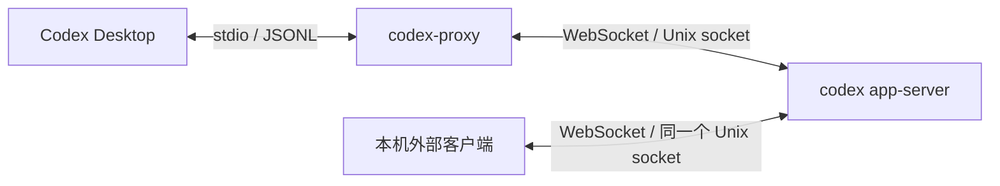

# codex-proxy

`codex-proxy` 是一个 Go 启动器，让 Codex Desktop 和其他本机客户端可以连接同一个 `codex app-server`。

## macOS 架构



1. Codex Desktop 通过 `CODEX_CLI_PATH` 启动 `codex-proxy`，并通过标准输入和输出交换 JSONL 消息。
2. `codex-proxy` 启动真实的 Codex CLI，让 `app-server` 监听本地 Unix socket，并在 JSONL 和 WebSocket 消息之间双向转发。
3. 外部客户端可直接通过该 socket 建立独立的 WebSocket 连接。每条连接各自初始化，使用同一个 `threadId` 即可访问同一条 Codex 会话。

## 构建

需要 Go 1.23 或更高版本。在仓库根目录运行 `make -C codex-proxy`，生成 `codex-proxy/bin/codex-proxy`。如果已经在 `codex-proxy/` 目录内，直接运行 `make` 即可。

## 平台源码与分发

macOS 传输实现及安装说明位于 [mac](./mac/README.md)，Windows 传输实现及安装说明位于 [windows](./windows/README.md)。在本组件目录运行 `make package` 可生成两个平台的离线安装包。构建依赖与按平台打包方式见[目录与打包说明](./BUILD.md)。

## 从 Dock 或访达启动 Codex Desktop

完全退出 Desktop 后，在 `mac/` 目录运行 `make configure` 并提供真实 CLI 路径。变量说明及示例见 [macOS 手动接入说明](./mac/README.md)。

配置后，从 Dock 或访达点击原来的 Codex Desktop 图标即可启动。在同一次 macOS 登录期间，退出后可继续点击图标重新打开。注销或重启 Mac 后，需要重新配置这些变量。

- `CODEX_CLI_PATH` 指定 Desktop 启动的 helper。
- `CODEX_PROXY_REAL_CODEX` 指定 helper 调用的真实 CLI。省略时从 helper 的 `PATH` 查找 `codex`。
- `CODEX_PROXY_SOCKET_PATH` 指定完整 socket 文件路径，优先于旧目录设置。
- 旧变量 `CODEX_PROXY_SOCKET_DIR` 指定一个尚不存在的绝对目录。helper 创建目录及其中的 `app.sock`，并在正常退出时清理。省略时使用临时目录，并将地址写到 stderr。

## 连接本地 socket

在本组件目录，可从终端连接已配置的 socket：

```sh
make -C mac connect SOCKET="$HOME/data/codex/socket/app.sock"
```

自定义客户端通过 Unix socket 建立 WebSocket 连接，然后发送 `initialize` 请求和 `initialized` 通知。协议细节见 [Codex App Server 文档](https://learn.chatgpt.com/docs/app-server#protocol)。
